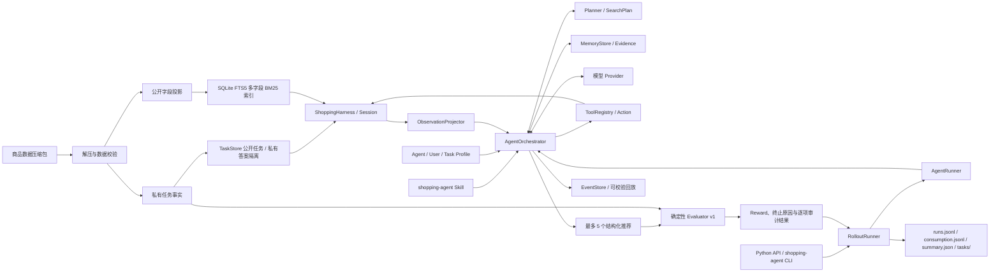

# Shopping Simulator Harness

<div align="center">

面向中文购物 Agent 的 Profile、Planning、Tools、Memory、Action、Observation 与 Orchestration 运行框架

<br />

[](pyproject.toml)
[](pyproject.toml)
[](src/data/search_bm25.py)
[](src/harness/evaluator.py)

<br />

公开任务与 Profile → 显式计划 → 工具与证据记忆循环 → 结构化推荐 → 隔离评分与事件回放

</div>

## Harness 是什么？

Shopping Simulator Harness 是一个轻量、可审计的购物推荐评测核心。它把原始商品与
任务数据转换为只读商品目录和确定性搜索索引，为 Agent 提供公开任务与商品信息，并在
终局使用私有标注检查推荐结果。

当前包版本为 0.6.0，提供七模块 Agent Runtime。`AgentRunner` 是对外入口，
`AgentOrchestrator` 管理 Profile、显式计划、任务记忆、工具状态、预算与终止；
模型通过 `update_plan`、`record_evidence` / `record_evidence_batch`、`read_evidence`
参与规划、证据判断与归档读取，通过三个环境工具
搜索、检查与提交。每轮根据计划与记忆重建有界上下文，并记录可校验的事件链。
项目保持 Provider 中立，不负责模型训练，也不依赖 Shopping GRPO 项目。
`RolloutRunner` 和 `shopping-agent` CLI 进一步提供确定性任务采样、有界并发执行、
持久化运行记录与聚合指标。

完整协议、模块边界、预算语义和迁移说明见 [Runtime v5 架构](docs/architecture.md)。
项目还提供用户澄清与恢复、显式长期偏好、长程交互 Episode，以及多配置重复实验。
可以按目标选择入口：

| 目标 | 入口 | 说明 |
|---|---|---|
| 对数据集任务生成推荐并评分 | `run` / `rollout` | 单任务或有界并发批量执行 |
| 使用自己的需求和公开商品源 | `chat` / `resume` | 用户澄清、证据保留与等待恢复 |
| 比较完整需求与逐步披露需求 | `episodes prepare/run/compare` | 冻结需求缓存、用户模拟与配对 baseline |
| 比较模型、配置及重复运行 | `experiments run/report` | 任务级统计、失败分类与离线报告重建 |
| 检查已保存的执行过程 | `replay` / `episodes replay` | 事件链校验与状态重建 |

## 无需 API Key 的离线演示

先按下方安装步骤准备 Python 和依赖，再在仓库根目录执行。示例均自带合成商品和
脚本化 Provider，不需要原始数据或外部模型；输出目录必须尚不存在。

基础运行时与事件回放：

```bash
python -m examples.runtime_demo --output-dir outputs/runtime-demo
python -m src.harness.cli replay --run-dir outputs/runtime-demo
```

演示使用合成商品和脚本化 Provider，执行计划、搜索、详情、证据读取、批量判断、提交六个动作，
校验严格成功和离线回放。它验证工程链路，不代表真实模型成功率或推理成本。

长程交互与多配置评测：

```bash
python -m examples.long_horizon_demo --output-dir outputs/long-horizon-demo
python -m examples.evaluation_demo --output-dir outputs/evaluation-demo
```

前者验证需求逐步披露、SQL 过滤和配对 baseline；后者运行 3 个任务 × 3 次重复 ×
2 个上下文配置，并验证报告重建。示例指标和 Token 用于工程验证，不能当作真实模型成绩。

## 项目做了什么？



| 模块 | 作用 | 入口 |
|---|---|---|
| 数据准备 | 解压数据、校验全量数据与 ASIN、原子化构建索引 | `shopping-harness-prepare` |
| 商品目录 | 搜索公开商品摘要，按 ASIN 获取公开详情 | `ProductCatalog` |
| 任务仓库 | 生成不包含答案的稳定任务 ID，隔离公开 Query 与私有 Gold Facts | `TaskStore` |
| 确定性评分 | 校验提交格式、商品、规格与目标匹配情况 | `evaluate_submission` |
| 单任务 Session | 受控搜索、详情访问与终局提交，记录有界可回放轨迹 | `ShoppingSession` |
| Harness 管理层 | 校验数据契约，创建、分发、查询和释放多个隔离 Session | `ShoppingHarness` |
| Agent 定义与策略 | 约束检索、候选比较、规格选择和终局提交 | `skills/shopping-agent/SKILL.md` |
| 模型 Provider | 统一消息、工具调用、终止原因和 Token Usage | `ModelProvider` |
| DeepSeek Provider | DeepSeek Chat Completions 请求、解析与有界重试 | `DeepSeekProvider` |
| Profile / Planning | 区分身份、背景偏好与任务，维护查询和约束来源 | `AgentProfile / UserProfile / Planner` |
| Memory | 记录候选、查询、观察引用和逐项判断，生成有界视图 | `MemoryStore` |
| Tools / Action / Observation | 基础九工具，按交互/多角色模式增加工具；动作、观察和可用状态 | `ToolRegistry / ActionProposal / AgentAction / AgentObservation` |
| Orchestration | 管理循环、预算、上下文、事件与停止条件 | `AgentOrchestrator` |
| Agent Runner | 稳定的单任务 Python/CLI 入口 | `AgentRunner` |
| Rollout Runner | 采样或接收任务列表，并发运行并聚合质量、Token 与耗时指标 | `RolloutRunner` |
| 长程交互 | 隐藏需求缓存、逐步披露、偏好快照、独立私有指标 | `EpisodeRunner` |
| 实验评测 | 固定任务 × 重复 × 配置，配对统计及报告重建 | `shopping-agent experiments` |
| 命令行 | 运行任务、交互、Episode 和实验，写入审计产物 | `shopping-agent` |

## 核心设计

### 用户交互、长期偏好与公开商品源

- `AgentRunner.run_query` 使用 `InteractiveHarness`，以真实 query 开始无私有标注的任务。
- `ask_user` 返回 `waiting_for_user`；`resume` 接收真实回复，保留累计预算与已观察证据。
- 用户明确授权后可替换已有硬约束；回复有来源 ID，恢复后必须重新解析需求。
- `PreferenceStore` 按用户保存显式偏好，支持版本冲突检测与修改记录；任务选择不会自动写成偏好。
- `JsonProductSource` 接收公开商品文件；`HttpProductSource` 调用明确配置的商品网关，记录来源与观察时间。
- 交互任务 `evaluation=null`；原离线 `run / rollout` 的评分保持独立。

无需 API Key 的完整演示：

```bash
python -m examples.stage_three_demo --output-dir outputs/stage-three-demo
python -m src.harness.cli replay --run-dir outputs/stage-three-demo/completed
```

真实模型入口：

```bash
shopping-agent chat --query '寻找300元以内的耳机，颜色还没决定' \
  --source-json examples/public-products.json --currency CNY \
  --artifacts-dir outputs/interactive-01
```

仅在返回 waiting_for_user 时使用 `shopping-agent resume --run-dir ... --reply ...`。
恢复、偏好命令及商品网关协议见 [第三阶段说明](docs/stage-three.md)。

### 候选比较与规格核验

搜索增加类别/品牌/价格过滤、分页、排除已见商品和公开匹配片段；`get_product(fields=...)`
可按字段读取，未读取字段在记忆和回放中保持“未观察”。新增 `compare_products` 对齐候选与需求，
`verify_selection` 检查所选规格、组合可用性和价格；上下文提供最多五条轻量动作建议。
这些操作只使用公开需求与本任务已观察证据，不调用额外模型或读取评分答案。

完整参数、边界与迁移见 [第二阶段说明](docs/stage-two.md)。离线演示：

```bash
python -m examples.comparison_demo --output-dir outputs/comparison-demo
python -m src.harness.cli replay --run-dir outputs/comparison-demo
```

演示使用合成商品和脚本化 Provider，验证九动作、四环境调用与回放，不代表真实模型成功率。

### 决策基础与提交前检查

TaskProfile 明确区分 `unparsed` / `parsed`。提交前必须成功调用 `update_plan`；
空约束需提供 `no_constraints_reason`，不能把 bootstrap 的空列表当作已完成需求分析。
默认 `verified` 提交要求每件商品的全部硬约束已有带引用的 satisfied 判断，并检查
公开规格及组合可用性。`best_effort` 必须逐项列出 unknown/violated 的 `gaps`，
且将每项 disclosure 原文写入对应推荐理由。检查失败返回可修正的问题列表，不封闭 Session。

完整公开详情按观察 ID 保存在任务级 `evidence_archive`，通过 `read_evidence` 按字段
分页读取；`record_evidence_batch` 可原子记录最多 30 项判断，两者都不消耗环境步数。
上下文展示约束矩阵、事实预览及原始证据引用；排序优先保留无硬冲突的候选。
模型对需求的提取和对证据的语义解释仍属于模型判断，提交前检查不等同于私有评分。
旧三动作 Agent 脚本需要补充计划和证据；底层 Harness / Session API 与 Evaluator 保持兼容。

### 公开商品目录

索引构建时只把白名单字段写入 `product_catalog`：

- ASIN、标题、品牌和类别；
- 价格范围与原始价格列表；
- 商品描述与属性；
- 可选规格、规格组合及可用状态；
- 商品图片。

任务指令、用户画像、Worker 信息和其他私有标注不会进入公开商品对象。运行时数据库以
只读模式打开；索引 schema、公开投影版本、源数据 SHA-256、Python 与 SQLite 版本都
记录在 Manifest 中，版本不兼容或哈希不一致时直接失败。

### 多字段 BM25 检索

检索使用 SQLite FTS5，对文本进行 NFKC 与大小写归一化，并组合中文二元词、英文、
数字和商品型号。当前字段权重为：

| 字段 | 权重 |
|---|---:|
| 标题 `title` | 3.0 |
| 型号 `model` | 2.5 |
| 品牌 `brand` | 2.0 |
| 类别 `category` | 2.0 |
| 属性 `attributes` | 1.5 |
| 规格 `options` | 1.2 |
| 卖点 `bullets` | 0.8 |

结果先按 BM25 分数排序，同分时按 ASIN 升序，单次最多返回 50 个商品。

### 公开任务与私有答案隔离

Actor 只能读取：

```json
{
  "task_id": "task_0123456789abcdef01234567",
  "query": "用户的购物需求"
}
```

Evaluator 独立读取目标 ASIN、目标类别、目标规格、属性、价格和数据来源位置。
`task_id` 由源数据行号、指令序号和 Query 生成稳定的截断 SHA-256，但不会直接暴露
目标商品 ASIN。运行集合使用 `all` 和固定的 `test` 子集，支持带 Seed 的确定性
采样；原始 `tag` 仅保留为来源信息。

规格标注优先按原文精确匹配，再按共享的 NFKC、大小写与字母数字归一化规则匹配。
不能唯一映射到商品规格轴的标注会被保留为 `unresolved_option_values`，不会被静默
猜测。

### Evaluator v1

Evaluator 不调用 LLM，只根据私有任务事实和公开商品目录评分：

| 结果 | Reward | `reward_valid` | 条件 |
|---|---:|---:|---|
| `strict_success` | 1.0 | `true` | 命中目标 ASIN，所需规格完全正确，且提交合法 |
| `partial_match` | 0.25 | `true` | 推荐中包含目标 ASIN，但缺少或选错所需规格 |
| `no_match` | 0.0 | `true` | 提交合法，但没有命中目标 ASIN |
| `invalid_submission` | 0.0 | `false` | 空提交、超过 5 项、重复/未知 ASIN、空理由或非法/不可用规格 |
| `unverifiable_task` | 0.0 | `false` | Gold 规格标注无法唯一映射，因而不能可靠评分 |

结果同时包含目标商品出现的排名、提交级错误，以及每条推荐的商品存在性、ASIN 匹配、
规格合法性和严格匹配状态，便于离线复放与问题定位。

## 数据概览

现有本地数据的原始来源标签统计如下；Train/Eval 是源数据标签，不是 CLI 的任务集合：

| 原始标签 | 商品数 | 任务数 | 含未解析规格的任务 |
|---|---:|---:|---:|
| Train | 21,962 | 21,962 | 26 |
| Eval | 1,459 | 1,459 | 6 |
| 合计 | 23,421 | 23,421 | 32 |

32 个任务共包含 33 个无法唯一解析的规格值。可以重新生成详细诊断报告：

```bash
python src/harness/test/test_tasks_unsolved.py
```

默认输出到 `data/test/tasks_unresolved.json`。`data/` 下的原始数据、解压结果、索引、
Manifest 和诊断产物均为本地文件，不纳入 Git。

## 环境要求

- Python 3.10 或更高版本；
- 支持 FTS5 的 SQLite（标准 Python 发行版通常已包含）；
- 数百 MB 可用磁盘空间，用于压缩包、解压后的 JSON 和生成索引；
- 运行核心 Harness 不需要 GPU；
- 仅在运行 DeepSeek Agent 时需要 API Key 和可访问 Provider 的网络。

## 快速开始

以下命令均在仓库根目录执行。

### 1. 创建环境并安装

```bash
python3 -m venv .venv
source .venv/bin/activate
python -m pip install -e ".[dev]"
```

核心依赖只有 Pydantic 2；`dev` 额外安装用于本地数据预览的 DuckDB。

### 2. 准备数据

将数据压缩包放在：

```text
data/fine_items_eval_train_all.json.gz
```

然后执行：

```bash
shopping-harness-prepare
```

脚本会依次完成解压、数据校验、公开字段投影和 SQLite 索引构建，并输出可审计的
Manifest。若要重新解压并强制重建索引：

```bash
shopping-harness-prepare --force
```

生成的主要文件为：

```text
data/fine_items_eval_train_all.json
data/product_search.sqlite3
data/product_search.manifest.json
```

### 3. 运行一次完整评测

下面的示例演示公共 Actor 边界和私有 Evaluator 边界。真实 Agent 应根据 `task.query`
通过 `harness.dispatch()` 搜索、读取候选详情，再构造提交；示例中的 ASIN 和规格
仅表示 Agent 最终决策。

```python
from pathlib import Path

from src.harness.harness import ShoppingHarness

data_dir = Path("data")
with ShoppingHarness(
    products_path=data_dir / "fine_items_eval_train_all.json",
    index_path=data_dir / "product_search.sqlite3",
) as harness:
    task_id = harness.sample_task_ids("test", 1, seed=42)[0]
    started = harness.create_session(task_id)
    session_id = started.state.session_id

    # Actor 只能看到 PublicTask 和各步公开 observation。
    search_step = harness.dispatch(
        session_id,
        "search_products",
        {"query": started.public_task.query, "limit": 20},
    )
    candidate = search_step.observation[0]
    harness.dispatch(
        session_id,
        "get_product",
        {"asin": candidate["asin"]},
    )
    harness.dispatch(
        session_id,
        "submit_recommendations",
        {
            "recommendations": [
                {
                    "asin": candidate["asin"],
                    "selected_options": {},
                    "reason": "根据需求、属性和价格筛选出的候选商品",
                }
            ]
        },
    )
    result = harness.get_evaluation(session_id)

print(result.model_dump_json(indent=2))
```

## 使用 Agent Runner + DeepSeek（可选）

仓库提供不依赖第三方 HTTP SDK 的同步 DeepSeek Provider。`AgentRunner` 只依赖统一的
`ModelProvider` 协议：它会加载完整 `shopping-agent` Skill，从九个基础工具中按状态
暴露可用工具；交互模式增加 `ask_user`，多角色模式增加 `review_progress`。
每轮执行一次动作并更新计划与记忆，直到提交、等待用户或明确失败。
默认使用单 Agent；`--agent-mode multi` 显式启用 Planner、Executor、Observer 的
顺序协作，三个角色共享公开记忆和全局预算，由 Observer 审阅候选后允许提交。

```dotenv
# .env 或 src/.env
DEEPSEEK_API_KEY=your-api-key
```

CLI 会按顺序查找当前目录的 `.env`、当前目录的 `src/.env`、仓库根目录的
`.env` 和 `src/.env`，并兼容已有的 `DEEPSEEK_API` 变量名。进程环境变量
优先，不会被 `.env` 覆盖。也可使用 `--env-file PATH` 指定文件，或用
`--no-env-file` 禁止自动加载。不支持变量插值，文件解析错误会直接终止命令。

```python
from pathlib import Path

from src.harness.agent import AgentRunner
from src.harness.env import load_dotenv
from src.harness.harness import ShoppingHarness
from src.harness.providers import DeepSeekProvider

load_dotenv()  # Python API 需要显式加载 .env；CLI 会自动加载。
provider = DeepSeekProvider(
    model="deepseek-v4-flash",
    default_parameters={"temperature": 0},
)
data_dir = Path("data")
with ShoppingHarness(
    products_path=data_dir / "fine_items_eval_train_all.json",
    index_path=data_dir / "product_search.sqlite3",
) as harness:
    task_id = harness.sample_task_ids("test", 1, seed=42)[0]
    result = AgentRunner(provider=provider, harness=harness).run(task_id)

print(result.model_dump_json(indent=2))
```

默认 Base URL 为 `https://api.deepseek.com`，默认模型名为
`deepseek-v4-flash`。可以显式传入 `api_key`、`base_url`、`model`、`timeout`、
`max_retries` 和默认推理参数。Provider 只支持非流式 Chat Completions；旧的
`DeepSeekClient` 和 `call_deepseek` 导入仍作为兼容层保留。`AgentRunner` 的库级默认
`tool_choice="required"`；文本代替提交、同轮多个工具、Provider 错误和模型轮次耗尽
都会返回带完整消息、
Token Usage 与 Session 快照的 `AgentRunResult`。

## 命令行与批量 Rollout

安装项目并在进程环境或 `.env` 中设置 `DEEPSEEK_API_KEY` / `DEEPSEEK_API` 后，
可使用 `shopping-agent` 命令。
默认数据路径是 `data/fine_items_eval_train_all.json`，索引路径是
`data/product_search.sqlite3`。

### 单任务

运行一个显式任务并将完整 `AgentRunResult` 输出到标准输出：

```bash
shopping-agent run \
  --task-id task_0123456789abcdef01234567 \
  --model deepseek-v4-flash \
  --max-steps 20
```

使用 `--output result.json` 可写入新文件；如果文件已存在，命令会拒绝覆盖。

### 批量 Rollout

使用固定 Test 子集测试完整通路：

```bash
shopping-agent rollout \
  --split test \
  --workers 4 \
  --model deepseek-v4-flash \
  --output-root outputs/rollouts
```

Harness 和 Agent 只使用 `all` 与 `test`，不再按原始 `tag` 划分 train/eval。
`all` 覆盖所有任务；`test` 使用固定整数 Seed 42 从全量任务中按任务 ID 的 SHA-256
排序选取 500 条（不足 500 条时全部选取），并按源数据顺序返回，用于验证通路。
Test 是 all 的子集，仍计入全量检测；商品检索索引始终包含全部商品。
数据准备 manifest 的 `tasks.test_subset` 记录 Test 的任务 ID、Seed 与数量上限。
原始数据文件名和标签保留为来源信息，不参与任务筛选。

省略 `--count` 运行所选集合的全部任务；指定时按 `--seed` 确定性抽样，
不会改变固定 Test 集的成员。全量检测运行：

```bash
shopping-agent rollout --split all
```
也可以多次传入 `--task-id` 来运行显式任务列表：

```bash
shopping-agent rollout \
  --task-id task_0123456789abcdef01234567 \
  --task-id task_89abcdef0123456789abcdef \
  --workers 2
```

每项任务使用独立 Provider、AgentRunner 和 Session；共享的 Harness 继续负责
只读目录、Session 隔离和确定性评估。`--workers` 可设为 1–64，输出记录
始终按输入任务顺序排列，不受并发完成顺序影响。

CLI 默认使用 `--tool-choice auto` 以兼容 DeepSeek thinking 模式。Runner 仍要求任务
最终通过 `submit_recommendations` 完成，不接受普通文本替代结构化提交。

每次 rollout 创建不可覆盖的独立目录：

```text
outputs/rollouts/rollout_<UTC时间>_<随机后缀>/
  runs.jsonl                       每项任务的完整 AgentRunResult 或异常记录
  consumption.jsonl                每项任务的耗时、轮次、工具数和 Token 消耗
  summary.json                     配置、任务顺序、质量与 Token 汇总
  tasks/000001/                    第一项任务的七模块审计包
    run_manifest.json              版本、配置、索引信息与最终事件哈希
    profile.json                   Agent / User / Task Profile
    plan.json                      最终计划
    events.jsonl                   动作、观察、状态更新和实际模型上下文
    final_memory.json              最终任务记忆
    evaluation.json                独立私有评分
    summary.json                   逐任务计数与终止状态
```

汇总包含完成率、严格成功率、Reward 覆盖率、全任务平均 Reward、有效 Reward 平均值、
终止原因、模型轮次、环境工具调用数、运行时动作数、搜索数、Token Usage 和耗时。`average_reward` 以所有请求任务为
分母，未得到有效 Reward 的任务按 0 计；`average_valid_reward` 只统计
`reward_valid=true` 的任务。单项模型或运行错误不会中断其余任务。

`runs.jsonl` 的每条记录都带有 `consumption`，其中包含该任务的 wall time、模型轮次、
Harness 工具调用数，以及输入、输出、缓存、缓存未命中、推理和总 Token。相同的精简
记录会单独写入 `consumption.jsonl`，便于直接加载统计；Provider 价格可能变化，因此
框架记录原始 Token，不自动换算金额。

通用参数同时适用于 `run` 和 `rollout`：`--env-file` / `--no-env-file`、
`--products-path`、`--index-path`、`--skill-dir`、`--provider`、`--model`、
`--tool-choice`、`--base-url`、`--temperature`、`--max-steps`、
`--max-model-turns`、`--timeout`、`--max-retries`、`--retry-backoff` 和
`--provider-parameters JSON`。额外 Provider 参数会写入 Rollout 元数据，其中名称包含
key、token、password、secret 或 authorization 的顶层字段会被遮盖。

Runtime 提供三个通用 JSON 配置入口：`--runtime-config`、`--agent-profile`、
`--user-profile`，可直接使用 [examples](examples/) 中的文件。单任务可通过
`--artifacts-dir` 保存审计包，原 `--output` 仍输出完整结果 JSON。

```bash
shopping-agent run --task-id TASK_ID \
  --runtime-config examples/runtime.json \
  --user-profile examples/user-profile.json \
  --artifacts-dir outputs/my-agent-run
shopping-agent replay --run-dir outputs/my-agent-run
shopping-agent schema
```

将 TASK_ID 替换为真实任务 ID。`schema` 导出公共 JSON Schema；`replay` 校验事件链并
恢复记录中的公开状态，两者都不需要 API Key。完整预算边界见 [架构说明](docs/architecture.md)。

Seed 保证任务采样和结果排列可复现；Harness 检索和 Evaluator 也是确定性的。
但远程模型输出是否完全复现仍取决于 Provider 服务、模型版本与请求参数。

## 长程交互 Episode

Episode 将完整需求离线解析为带原文引用的要求，并冻结到私有 SQLite 缓存。Actor
先看到部分需求，通过 `ask_user` 获取相关披露，再更新计划和偏好状态。默认模拟器
按问题主题返回原文事实，不读取目标商品；Actor 与私有评分数据分别保存。

先准备已经构建好的商品数据与索引，再生成需求缓存：

```bash
shopping-agent episodes prepare \
  --products-path data/fine_items_eval_train_all.json \
  --cache data/episodes.sqlite3 --split test --count 20 \
  --parser structured --model deepseek-v4-flash

shopping-agent episodes compare \
  --cache data/episodes.sqlite3 --count 20 \
  --config examples/long_horizon.json \
  --output-dir outputs/episode-comparison
```

`structured` 解析和真实模型评测会调用 Provider；缓存复用后评测不再调用解析器。
`--parser rule --no-env-file` 可离线解析有限词汇，未覆盖的需求会保留供检查。
Full Query 与 Long-Horizon 使用相同任务、目标、索引、模型和资源配置进行配对。

可执行的硬约束在 SQLite 的 Top-K 截断前过滤商品，规格和价格必须由同一个可用组合
同时满足。额外指标包括约束满足/验证覆盖、遗忘/遗漏/违反、重复提问、过早推荐和
候选集缩减；原 Evaluator v1 的目标 ASIN 与规格评分保持独立。

单条 Episode 输出的 `public/` 保存可供 Actor 查看轨迹，`private/` 保存评分、披露
审计和来源信息。完整命令、指标口径及数据边界见 [长程交互文档](docs/long-horizon.md)。

## 多模型、多配置与重复评测

使用 [实验配置示例](examples/evaluation-matrix.json) 定义参考组、候选配置和重复种子：

```bash
shopping-agent experiments run \
  --config examples/evaluation-matrix.json \
  --split test --count 20 --output-dir outputs/evaluation-01

shopping-agent experiments report \
  --run-dir outputs/evaluation-01 --output-dir outputs/evaluation-01-report
```

示例矩阵计划执行 20 个任务 × 3 次重复 × 2 组，共 120 次 Agent 运行。
各组可配置模型、Base URL、Provider 参数、Skill 和 Runtime；凭据从组配置的
`api_key_env` 环境变量读取，默认 `DEEPSEEK_API_KEY`。实验按任务/重复块随机化各组
执行顺序并串行运行，普通 `rollout` 的线程并发与此独立。

报告包含成功率、有效评分覆盖、模型轮次、工具调用、Token、耗时、稳定性及失败分类；
Episode 模式还包含交互和约束指标。重复运行先在同一任务内聚合，再按任务等权统计，
输出配对差值、任务聚类 bootstrap 置信区间和多重比较校正。失败运行保留在成功率分母中，
缺失或不完整 Token 记为 null。

产物写入 `outputs/evaluation-01/private/`，包括 `manifest.json`、`records.jsonl`、
逐次审计包、`summary.json`、`metrics.csv` 和 `report.md`。`experiments report`
校验记录并重建报告，无需 API Key 或再次调用模型。详细定义见
[Agent 多维配对评测](docs/evaluation-experiments.md)。

## 运行测试

```bash
python -m unittest discover -s src/harness/test -p "test_*.py" -v
```

当前测试覆盖公开字段防泄漏、BM25 顺序、索引与 Manifest 校验、任务规格归一化、
Evaluator 各终局分支、Agent 完整工具循环与失败边界，以及 Provider 消息契约、
DeepSeek 工具调用解析、Token Usage、重试和错误处理，以及 `.env` 加载、
Rollout 采样、并发顺序、逐任务消耗、指标聚合、原子化产物写入和 CLI 参数校验。
扩展测试还覆盖计划与证据、交互恢复、偏好版本、SQL 约束过滤、Episode 缓存与披露、
Actor 输入防泄漏、长程指标及实验统计/报告重建。未解析规格扫描脚本是数据诊断工具，
不会调用外部 API。

## 仓库结构

```text
pyproject.toml                    包元数据、依赖与命令行入口
data/                             本地数据、索引、Manifest、Episode 缓存与诊断结果
docs/                             架构、交互、长程 Episode 与实验评测说明
examples/                         离线演示、公开商品和 Runtime/实验配置
src/data/
  decompress.py                   Gzip 解压
  validate.py                     全量数据完整性校验
  product_projection.py           原始商品到公开白名单字段的投影
  search_bm25.py                   分词、多字段 BM25、目录和 Manifest
  product_facts.py                 公开字段的类型化约束与规格价格判断
  search_vector.py                可选向量索引组件（不属于当前 BM25 benchmark）
  build_index.py                  流式读取 JSON 并构建索引
  pipeline.py                     一键数据准备入口
src/harness/
  schemas.py                      Pydantic 输入、输出与评测 Schema
  catalog.py                      只读公开商品目录
  tasks.py                        公开任务与私有 Gold Facts 隔离
  evaluator.py                    确定性推荐评分
  env.py                          不覆盖进程变量的轻量 .env 加载器
  session.py                      单任务工具状态机与公开轨迹
  harness.py                      多 Session 生命周期与统一分发入口
  agent/
    contracts.py                  版本化 Profile / Plan / Action / Observation / Memory 契约
    profile.py                    约束来源与任务优先规则
    planner.py                    计划修订与阶段推进
    memory.py                     任务级候选与证据记忆
    tools.py                      环境和运行时工具注册表
    observations.py               公开观察投影
    context.py                    有界上下文构建
    comparison.py                 已观察商品比较、规格与价格核验
    proposals.py                  基于信息缺口的动作候选与重复签名
    policy.py                     Provider 决策适配
    submission.py                 基于公开需求与观察证据的提交前检查
    orchestrator.py               七模块执行循环和预算
    multiagent.py                 Planner / Executor / Observer 角色交接
    events.py                     追加式事件链及回放
    artifacts.py                  审计包保存和一致性校验
    runner.py                     单任务入口
    rollout.py                    批量调度和指标聚合
    skill.py                      购物策略加载
  interactive.py                  无私有标注的真实用户环境与会话恢复
  sources.py                      JSON/HTTP 公开商品源和来源元数据
  agent/preferences.py            按用户保存显式长期偏好与修改版本
  episodes/                       需求解析、缓存、模拟器、执行、指标及配对 baseline
  experiments/                    评测矩阵、逐次记录、统计及报告重建
  constraints.py                  类型化需求谓词
  cli.py                          任务、交互、Episode、实验和回放命令入口
  providers/base.py               Provider 协议、消息、工具调用和 Usage Schema
  providers/deepseek.py           DeepSeek Chat Completions Provider
  api/                            旧 DeepSeek 客户端导入兼容层
  test/                           契约测试与数据诊断工具
skills/
  shopping-agent/                 Agent 定义、购物策略与 Harness 工具契约
```

`skills/` 是本项目的 Skill 库。每个 Skill 目录以 `SKILL.md` 为入口；其中的
`references/` 只是该 Skill 按需加载的参考资料，不是另一套 Skill 库。

## 当前范围与限制

- Evaluator v1 只认可数据集标注的目标 ASIN，不推断等价替代商品；
- 当前 Reward 只使用目标 ASIN 和必选规格；`required_attributes` 与价格事实已保留，
  但尚未进入 v1 评分公式；
- 当前提供线程级批量 Rollout，但尚未提供跨机器调度、断点续跑或 Web 服务；
- Runner 失败时保留 active Session 供审计，库调用方可显式 force release；Rollout 自动释放；
- 候选与证据 Memory 为任务级；跨任务只保存用户显式偏好，尚未启用经验记忆；
- 证据工具验证引用来源与引文，不证明模型的语义判断正确；
- 事件在任务返回后写盘，支持明确等待用户时的文件恢复；尚不支持任意动作中的崩溃恢复；
- HTTP 来源是通用商品网关客户端，需接入实际网关；不含零售商专属集成、跨来源合并或购买操作；
- 当前 Actor 搜索契约只接受 `method=bm25`；仓库保留可选向量索引组件和 CLI 参数，
  尚不能把它们视为已贯通的 Agent 向量检索能力，长程 benchmark 使用 BM25；
- 需求解析的引用与 Schema 校验不证明语义提取正确；规则解析器只覆盖有限词汇；
- 实验与 Episode 对比会保留已完成记录，但尚不支持中断后自动续跑；
- 无法唯一解析的 Gold 规格会 Fail Closed，并返回 `reward_valid=false`。

这些约束让当前评分保持简单、可复放和可审计，也明确了后续扩展替代商品、属性/预算
评分和批量 Agent Runtime 时需要升级的协议边界。

## 文档导航

- [Runtime v5 架构与预算](docs/architecture.md)
- [候选比较与规格核验](docs/stage-two.md)
- [用户交互、恢复、偏好与商品源](docs/stage-three.md)
- [长程交互 Episode、指标与隔离边界](docs/long-horizon.md)
- [多配置配对评测与统计报告](docs/evaluation-experiments.md)

## 致谢

项目的数据与任务形态来自
[ShopSimulator](https://arxiv.org/pdf/2601.18225)，README 的组织方式参考同工作区的
Shopping GRPO 项目。
