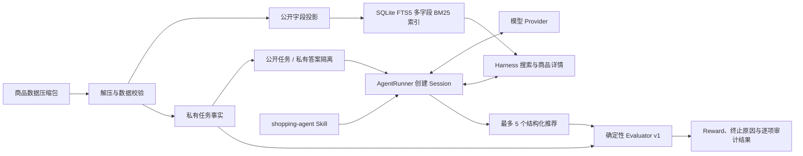

# Shopping Simulator Harness

<div align="center">

面向中文购物推荐 Agent 的确定性检索、任务隔离与评测框架

<br />

[](pyproject.toml)
[](pyproject.toml)
[](src/data/search_bm25.py)
[](src/harness/evaluator.py)

<br />

公开商品目录与私有答案隔离 → 多字段 BM25 检索 → 结构化推荐 → 可复放评分

</div>

## Harness 是什么？

Shopping Simulator Harness 是一个轻量、可审计的购物推荐评测核心。它把原始商品与
任务数据转换为只读商品目录和确定性搜索索引，为 Agent 提供公开任务与商品信息，并在
终局使用私有标注检查推荐结果。

Harness 不负责模型训练，并保持模型 Provider 中立。项目内置了可版本化的
`shopping-agent` Skill，用于定义 Agent 身份、购物策略和工具契约；`AgentRunner`
加载该 Skill，驱动 Provider 调用 Harness 工具并在终局提交结构化推荐。整个加载、
分析、工具执行和评估链路都位于本仓库，不依赖 Shopping GRPO 项目。

## 项目做了什么？



| 模块 | 作用 | 入口 |
|---|---|---|
| 数据准备 | 解压数据、校验 ASIN 与 split、原子化构建索引 | `shopping-harness-prepare` |
| 商品目录 | 搜索公开商品摘要，按 ASIN 获取公开详情 | `ProductCatalog` |
| 任务仓库 | 生成不包含答案的稳定任务 ID，隔离公开 Query 与私有 Gold Facts | `TaskStore` |
| 确定性评分 | 校验提交格式、商品、规格与目标匹配情况 | `evaluate_submission` |
| 单任务 Session | 守卫搜索、详情访问与终局提交，记录有界可回放轨迹 | `ShoppingSession` |
| Harness 管理层 | 校验数据契约，创建、分发、查询和释放多个隔离 Session | `ShoppingHarness` |
| Agent 定义与策略 | 约束检索、候选比较、规格选择和终局提交 | `skills/shopping-agent/SKILL.md` |
| 模型 Provider | 统一消息、工具调用、终止原因和 Token Usage | `ModelProvider` |
| DeepSeek Provider | DeepSeek Chat Completions 请求、解析与有界重试 | `DeepSeekProvider` |
| Agent Runner | 加载 Skill，驱动单工具循环并生成完整运行审计结果 | `AgentRunner` |

## 核心设计

### 公开商品目录

索引构建时只把白名单字段写入 `product_catalog`：

- ASIN、标题、品牌和类别；
- 价格范围与原始价格列表；
- 商品描述与属性；
- 可选规格、规格组合及可用状态；
- 商品图片。

任务指令、用户画像、Worker 信息和其他私有标注不会进入公开商品对象。运行时数据库以
只读模式打开；索引 schema、公开投影版本、源数据 SHA-256、Python 与 SQLite 版本都
记录在 Manifest 中，版本不兼容或哈希不一致时直接失败。

### 多字段 BM25 检索

检索使用 SQLite FTS5，对文本进行 NFKC 与大小写归一化，并组合中文二元词、英文、
数字和商品型号。当前字段权重为：

| 字段 | 权重 |
|---|---:|
| 标题 `title` | 3.0 |
| 型号 `model` | 2.5 |
| 品牌 `brand` | 2.0 |
| 类别 `category` | 2.0 |
| 属性 `attributes` | 1.5 |
| 规格 `options` | 1.2 |
| 卖点 `bullets` | 0.8 |

结果先按 BM25 分数排序，同分时按 ASIN 升序，单次最多返回 50 个商品。

### 公开任务与私有答案隔离

Actor 只能读取：

```json
{
  "task_id": "task_0123456789abcdef01234567",
  "query": "用户的购物需求"
}
```

Evaluator 独立读取目标 ASIN、目标类别、目标规格、属性、价格和数据来源位置。
`task_id` 由源数据行号、指令序号和 Query 生成稳定的截断 SHA-256，但不会直接暴露
目标商品 ASIN。训练集与评测集按源数据的 `tag` 字段冻结，并支持带 Seed 的确定性
采样。

规格标注优先按原文精确匹配，再按共享的 NFKC、大小写与字母数字归一化规则匹配。
不能唯一映射到商品规格轴的标注会被保留为 `unresolved_option_values`，不会被静默
猜测。

### Evaluator v1

Evaluator 不调用 LLM，只根据私有任务事实和公开商品目录评分：

| 结果 | Reward | `reward_valid` | 条件 |
|---|---:|---:|---|
| `strict_success` | 1.0 | `true` | 命中目标 ASIN，所需规格完全正确，且提交合法 |
| `partial_match` | 0.25 | `true` | 推荐中包含目标 ASIN，但缺少或选错所需规格 |
| `no_match` | 0.0 | `true` | 提交合法，但没有命中目标 ASIN |
| `invalid_submission` | 0.0 | `false` | 空提交、超过 5 项、重复/未知 ASIN、空理由或非法/不可用规格 |
| `unverifiable_task` | 0.0 | `false` | Gold 规格标注无法唯一映射，因而不能可靠评分 |

结果同时包含目标商品出现的排名、提交级错误，以及每条推荐的商品存在性、ASIN 匹配、
规格合法性和严格匹配状态，便于离线复放与问题定位。

## 数据概览

当前本地数据集统计如下：

| Split | 商品数 | 任务数 | 含未解析规格的任务 |
|---|---:|---:|---:|
| Train | 21,962 | 21,962 | 26 |
| Eval | 1,459 | 1,459 | 6 |
| 合计 | 23,421 | 23,421 | 32 |

32 个任务共包含 33 个无法唯一解析的规格值。可以重新生成详细诊断报告：

```bash
python src/harness/test/test_tasks_unsolved.py
```

默认输出到 `data/test/tasks_unresolved.json`。`data/` 下的原始数据、解压结果、索引、
Manifest 和诊断产物均为本地文件，不纳入 Git。

## 环境要求

- Python 3.10 或更高版本；
- 支持 FTS5 的 SQLite（标准 Python 发行版通常已包含）；
- 数百 MB 可用磁盘空间，用于压缩包、解压后的 JSON 和生成索引；
- 运行核心 Harness 不需要 GPU。

## 快速开始

以下命令均在仓库根目录执行。

### 1. 创建环境并安装

```bash
python3 -m venv .venv
source .venv/bin/activate
python -m pip install -e ".[dev]"
```

核心依赖只有 Pydantic 2；`dev` 额外安装用于本地数据预览的 DuckDB。

### 2. 准备数据

将数据压缩包放在：

```text
data/fine_items_eval_train_all.json.gz
```

然后执行：

```bash
shopping-harness-prepare
```

脚本会依次完成解压、数据校验、公开字段投影和 SQLite 索引构建，并输出可审计的
Manifest。若要重新解压并强制重建索引：

```bash
shopping-harness-prepare --force
```

生成的主要文件为：

```text
data/fine_items_eval_train_all.json
data/product_search.sqlite3
data/product_search.manifest.json
```

### 3. 运行一次完整评测

下面的示例演示公共 Actor 边界和私有 Evaluator 边界。真实 Agent 应根据 `task.query`
通过 `harness.dispatch()` 搜索、读取候选详情，再构造提交；示例中的 ASIN 和规格
仅表示 Agent 最终决策。

```python
from pathlib import Path

from src.harness.harness import ShoppingHarness

data_dir = Path("data")
with ShoppingHarness(
    products_path=data_dir / "fine_items_eval_train_all.json",
    index_path=data_dir / "product_search.sqlite3",
) as harness:
    task_id = harness.sample_task_ids("eval", 1, seed=42)[0]
    started = harness.create_session(task_id)
    session_id = started.state.session_id

    # Actor 只能看到 PublicTask 和各步公开 observation。
    search_step = harness.dispatch(
        session_id,
        "search_products",
        {"query": started.public_task.query, "limit": 20},
    )
    candidate = search_step.observation[0]
    harness.dispatch(
        session_id,
        "get_product",
        {"asin": candidate["asin"]},
    )
    harness.dispatch(
        session_id,
        "submit_recommendations",
        {
            "recommendations": [
                {
                    "asin": candidate["asin"],
                    "selected_options": {},
                    "reason": "根据需求、属性和价格筛选出的候选商品",
                }
            ]
        },
    )
    result = harness.get_evaluation(session_id)

print(result.model_dump_json(indent=2))
```

## 使用 Agent Runner + DeepSeek（可选）

仓库提供不依赖第三方 HTTP SDK 的同步 DeepSeek Provider。`AgentRunner` 只依赖统一的
`ModelProvider` 协议：它会加载完整 `shopping-agent` Skill，根据 Action Schema 暴露
三个工具，逐轮执行一个工具调用并回灌公开 observation，直到提交或明确失败。

```bash
export DEEPSEEK_API_KEY="your-api-key"
```

```python
from pathlib import Path

from src.harness.agent import AgentRunner
from src.harness.harness import ShoppingHarness
from src.harness.providers import DeepSeekProvider

provider = DeepSeekProvider(
    model="deepseek-v4-flash",
    default_parameters={"temperature": 0},
)
data_dir = Path("data")
with ShoppingHarness(
    products_path=data_dir / "fine_items_eval_train_all.json",
    index_path=data_dir / "product_search.sqlite3",
) as harness:
    task_id = harness.sample_task_ids("eval", 1, seed=42)[0]
    result = AgentRunner(provider=provider, harness=harness).run(task_id)

print(result.model_dump_json(indent=2))
```

默认 Base URL 为 `https://api.deepseek.com`，默认模型名为
`deepseek-v4-flash`。可以显式传入 `api_key`、`base_url`、`model`、`timeout`、
`max_retries` 和默认推理参数。Provider 只支持非流式 Chat Completions；旧的
`DeepSeekClient` 和 `call_deepseek` 导入仍作为兼容层保留。Runner 默认要求模型调用
工具；文本代替提交、同轮多个工具、Provider 错误和模型轮次耗尽都会返回带完整消息、
Token Usage 与 Session 快照的 `AgentRunResult`。

## 运行测试

```bash
python -m unittest discover -s src/harness/test -p "*.py" -v
```

当前测试覆盖公开字段防泄漏、BM25 顺序、索引与 Manifest 校验、任务规格归一化、
Evaluator 各终局分支、Agent 完整工具循环与失败边界，以及 Provider 消息契约、
DeepSeek 工具调用解析、Token Usage、重试和错误处理。未解析规格扫描脚本是数据诊断
工具，不会调用外部 API。

## 仓库结构

```text
pyproject.toml                    包元数据、依赖与命令行入口
data/                             本地数据、索引、Manifest 与诊断结果
src/data/
  decompress.py                   Gzip 解压
  validate.py                     数据集完整性与 split 校验
  product_projection.py           原始商品到公开白名单字段的投影
  search_bm25.py                  分词、多字段 BM25、目录和 Manifest
  build_index.py                  流式读取 JSON 并构建索引
  pipeline.py                     一键数据准备入口
src/harness/
  schemas.py                      Pydantic 输入、输出与评测 Schema
  catalog.py                      只读公开商品目录
  tasks.py                        公开任务与私有 Gold Facts 隔离
  evaluator.py                    确定性推荐评分
  session.py                      单任务工具状态机与公开轨迹
  harness.py                      多 Session 生命周期与统一分发入口
  agent/                          Skill 加载、工具定义与 AgentRunner 循环
  providers/base.py               Provider 协议、消息、工具调用和 Usage Schema
  providers/deepseek.py           DeepSeek Chat Completions Provider
  api/                            旧 DeepSeek 客户端导入兼容层
  test/                           契约测试与数据诊断工具
skills/
  shopping-agent/                 Agent 定义、购物策略与 Harness 工具契约
```

`skills/` 是本项目的 Skill 库。每个 Skill 目录以 `SKILL.md` 为入口；其中的
`references/` 只是该 Skill 按需加载的参考资料，不是另一套 Skill 库。

## 当前范围与限制

- Evaluator v1 只认可数据集标注的目标 ASIN，不推断等价替代商品；
- 当前 Reward 只使用目标 ASIN 和必选规格；`required_attributes` 与价格事实已保留，
  但尚未进入 v1 评分公式；
- Agent Runner 当前是同步单任务循环，尚未提供 Rollout CLI、Web 服务、并发调度或
  批量实验汇总器；
- Runner 失败时保留 active Session 供审计，调用方需在确认后显式 force release；
- 无法唯一解析的 Gold 规格会 Fail Closed，并返回 `reward_valid=false`。

这些约束让当前评分保持简单、可复放和可审计，也明确了后续扩展替代商品、属性/预算
评分和批量 Agent Runtime 时需要升级的协议边界。

## 致谢

项目的数据与任务形态来自
[ShopSimulator](https://arxiv.org/pdf/2601.18225)，README 的组织方式参考同工作区的
Shopping GRPO 项目。
