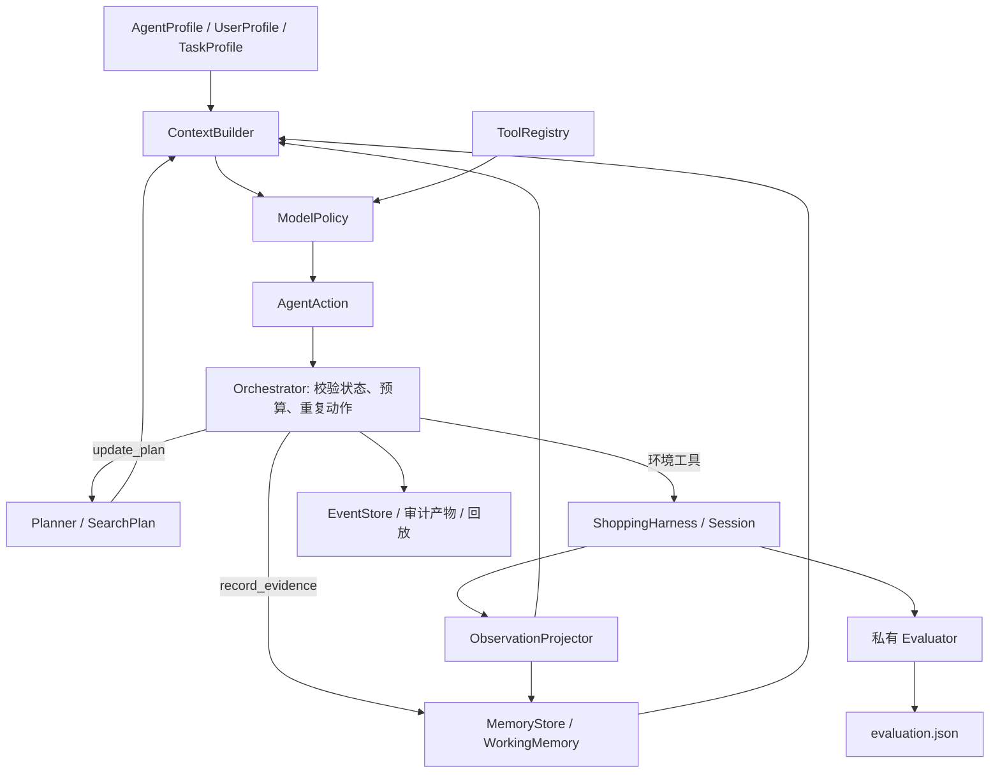

# Shopping Agent Runtime v5

Harness 0.5 将 Agent 定义为七个有版本的数据与执行模块。`AgentRunner` 是稳定入口，
`AgentOrchestrator` 负责控制循环，`ShoppingHarness / ShoppingSession` 负责真实工具执行
和评测隔离。底层商品目录、检索与 Evaluator 的评分含义不因重构而变化。

编排支持 `RuntimeConfig.orchestration_backend=native|langgraph`，默认 native。
LangGraph 后端以显式角色节点调度同一个单回合执行方法；LangSmith 可独立接入两个后端。
业务状态、Session 和评测隔离继续沿用本页契约，详见 [图编排与追踪](langgraph-tracing.md)。

第二阶段扩展了搜索参数、详情字段选择、比较与规格核验，并在上下文中提供轻量动作候选。
参数示例、部分观察的归档语义和价格边界见 [第二阶段说明](stage-two.md)。

第三阶段加入 InteractiveHarness、ask_user / resume、显式长期偏好、JSON/HTTP
ProductSource。交互任务不附带私有评测标签。协议、CLI 和恢复边界见
[第三阶段说明](stage-three.md)。离线模式仍为九工具，交互模式增加 ask_user。

## 源码布局：主线与可选支线

`src/harness/` 只保留离线 Test1 主线的七个模块与评测层；第三阶段的交互能力、
长程 Episode 与配对实验已归入 `src/harness/branch/`（`interactive.py`、
`preferences.py`、`episodes/`、`experiments/`）。依赖方向单向：支线可依赖主线，
主线不得依赖支线。唯一受控入口是 `cli.py` 的 `load_branch()`，它以
`try/except ImportError` 加载支线，缺失时相应子命令不注册。删除整个
`src/harness/branch/` 后主线仍完整可用，由 `test/test_branch_boundary.py`
在独立解释器中验证。本文余下部分的运行时契约不受该布局影响。



## 模块契约

| 模块 | 数据类型 | 责任与代码入口 |
|---|---|---|
| Profile | AgentProfile、UserProfile、TaskProfile、Constraint | `contracts.py`、`profile.py`：身份、偏好、任务原文、约束来源 |
| Planning | SearchPlan、PlanUpdate | `planner.py`：初始计划、模型修订、阶段推进、硬约束保护 |
| Tools | ToolRegistry、ToolSpec | `tools.py`：Schema、环境/运行时范围、副作用、状态可用性 |
| Memory | WorkingMemory、CandidateMemory、EvidenceAssessment | `memory.py`：查询、候选、引用、判断及有界上下文视图 |
| Action | AgentAction | `contracts.py`：运行内唯一 ID、顺序、工具参数、计划版本 |
| Observation | AgentObservation、BudgetState、ProjectionMetadata | `observations.py`：公开字段投影、因果关联、错误和资源反馈 |
| Orchestration | AgentOrchestrator | `orchestrator.py`：隔离状态、调用顺序、预算、终止与审计 |

所有新契约拒绝未知字段；配置不可在原对象上赋值。每次 run 新建计划、记忆、事件日志
和计数器，批量任务也不共享可变运行状态。现有 `AgentRunner(...)` Python 调用仍可用。

## Profile 与规划

AgentProfile 定义助手身份与目标，UserProfile 只包含调用方明确提供的背景偏好。
当前任务来自 PublicTask，不通过目标商品或评测事实补全。背景偏好和推断只能形成软约束。
当前 Query 优先于背景偏好；约束描述是否准确概括原文仍属于模型判断。

每个任务先从完整 Query 创建 bootstrap plan，不额外调用模型。模型通过 `update_plan`
生成结构化约束、最多五个查询、核验目标和简短修改说明。动作选择和计划生成使用同一个
Provider，通过不同工具协议区分。TaskProfile 初始 requirements_status=unparsed，
成功更新计划后变为 parsed；空约束必须提供 no_constraints_reason。
未解析时仍可搜索和检查，但不会开放提交，也不会因空硬约束列表自动推进到 submit。
解析准确性仍是模型判断，程序不会把“已解析”当作对需求完整性的语义证明。

查询约束的 source_quote 必须是 Query 的原文片段，偏好约束必须引用已有偏好。
重规划不能删除或修改已经记录的硬约束。软约束改变时，其旧判断被清除，避免新需求
沿用旧证据结论。引用 Observation ID 必须已经存在于当前任务。

Planner 根据公开状态推进 search / inspect / verify / submit。阶段是行动指导，
工具状态和终止仍由 Orchestrator 与 Session 控制。`completed` 表示已经提交，不代表
私有评分通过；`stopped` 表示运行在提交前结束。

## Memory 与证据

MemoryStore 自动从已返回的查询、搜索摘要和详情观察更新 WorkingMemory。候选记录
是否已检查、关联 Observation ID 和逐约束的 satisfied / violated / unknown 判断。
没有判断的约束也在上下文中显式显示为 unknown。

完整公开详情按原始 observation_id 存入 evidence_archive，随最终记忆和事件持久化。
上下文只显示价格范围、有限属性预览、规格轴及可读取引用，不直接拼入完整归档。
候选视图优先保留无硬冲突、硬条件满足较多的候选，再考虑检查状态、软偏好与检索排名；
明确硬冲突的商品不会因判断条数多而优先。视图提供 constraint_matrix、hard_conflicts、
evidence_ready 和 hard_conflict_count。evidence_ready 只表示模型证据记录覆盖，不代表私有评分。

read_evidence 支持 ASIN、原详情 observation_id、JSON Pointer 路径、offset 和 limit，
只能读取当前任务已查看的详情。返回最多 20 个标量片段和 12000 个序列化数据字符；
长字符串按 1000 字符切片，next_offset 用于继续读取。返回的 source_observation_id
用于后续引用，不将新的读取动作冒充为原始证据来源。读取不消耗环境步数。

`record_evidence` 必须引用同一商品的成功详情 Observation，字段路径为 RFC 6901
JSON Pointer，例如 `/attributes/0`、`/price_min`、`/customization_options/颜色/0/value`。
引文必须出现在该标量字段中。不能引用未观察商品、其他商品或整个容器对象。

程序校验引用来源和字面内容；判断是否足以支持“兼容”“满足预算”等结论仍由模型负责。
返回值用 `semantic_verification=model_assessment` 明确这一边界，Evaluator 不采用这些
自报判断作为评分真值。

record_evidence_batch 接收 1–30 条判断，每个商品/约束对唯一；全部引用先校验，
有一条非法就整批拒绝，已有判断保持原样。原 record_evidence 单条接口继续支持。
同一约束仍保存最新判断，尚未引入多证据冲突合并。

本版启用任务级 Working Memory。跨任务 Episodic Memory 和外部 Semantic Memory
尚未接入：没有默认向量库、自动沉淀答案或跨任务检索。用户偏好由调用方显式加载。
这使现有评测任务之间保持独立，也给后续知识库提供清楚的接入边界。
交互模式可由调用方从 PreferenceStore 显式加载长期偏好；它不是跨任务答案记忆。

## Tools、Action 与 Observation

环境工具仍为 search_products / get_product / submit_recommendations；运行时工具为
update_plan / record_evidence / record_evidence_batch / read_evidence。
`shopping_tool_definitions()` 仅返回三个原环境工具；`ToolRegistry.definitions`
返回完整九工具集合和带提交前检查字段的 submit Schema，Provider 请求按状态选择可用工具。

搜索和详情输入来自 Session 使用的相同 Pydantic Schema；AgentSubmission 扩展了提交协议。
规划和证据工具在 Runtime 内
更新状态，不假装成环境搜索，也不增加环境步数。所有工具尝试，包括拒绝，增加 action_count；
派发到 Harness 的调用才增加 tool_call_count。search_count 统计通过运行时 Guard 并
派发的搜索尝试。Rollout 同时汇总这三种开销。

Session 继续强制先搜索再检查、先检查再推荐。结构化工具可用性不等同于任意参数都合法。
未知工具、非法参数、无效引用、超过重复次数等被拒绝并返回可理解的观察。环境适配或
观察投影故障作为 runtime_error 保存，不能误报为模型参数错误。

Runtime 提交前检查要求 parsed 状态、1–5 个不同的已检查商品及合法可用的公开规格；
存在规格组合列表时，所选值必须能够匹配一个可用组合。默认 mode=verified 要求每件推荐
的全部硬约束都有 satisfied 判断。mode=best_effort 允许 unknown/violated，但 gaps 必须
逐项准确列出所有硬条件缺口，并将每条 disclosure 原文写进相应商品的 reason。
检查失败返回 submission_not_ready 与 data.issues，消耗动作但不派发环境工具，不封闭 Session。
mode/gaps 仅记录在 Runtime Action，派发时只传 recommendations。检查只使用公开任务和
本任务观察归档，不读取私有标签。它不验证模型语义判断；规格价格由 verify_selection
按已观察字段计算。提交前检查会重新核验已关联硬约束的预算检查，避免已知数值冲突被忽略。

Session v2 的提交观察只有 `{"submitted": true}`。评价保留在独立 evaluation 字段和
evaluation.json，所有 Actor Observation、WorkingMemory 和模型上下文都不包含评分。
AgentRunResult 的 session.evaluation 是离线审计入口，不能将整个结果重新灌给 Actor。

搜索服务没有提供总命中数，因此 projection.total_results=null；returned_items 仅表示
这次返回多少项。没有静默截断本轮商品详情。不要把返回页长度解释为总候选数。

## 预算与上下文

RuntimeConfig 默认最多 40 个动作、6 次搜索，同一规范化动作最多 2 次。搜索重复判断
做 NFKC、大小写和空白归一化，忽略 limit；尚不判断词序或同义改写的语义等价。
过滤条件、offset 和去重排序后的 exclude_asins 也参与签名，不把翻页或修改过滤误判为重复查询。
环境 max_steps 和模型 max_model_turns 独立设置。搜索次数耗尽后仍允许检查和提交。

max_total_tokens 和 max_duration_seconds 默认为 null。Token 限额按照 Provider 返回的
usage 累计，在调用之间及模型返回后检查；一次调用可能已经越过阈值，但不会继续派发
其动作。启用 Token 限额而 Provider 缺失 usage 时停止为 usage_unavailable。
耗时限制也是协作式检查，不会中断已在进行的同步 Provider/工具调用；请求超时和重试
由 Provider 的 timeout/max_retries 控制。它们不是精确的预付费或硬实时保证。

ContextBuilder 每轮重建 Profile + Plan + Memory + 最近完整 assistant/tool 对。
默认最多四组历史对、十个商品候选、五条动作建议。超过 context_max_chars 时先减少旧历史组，
再移除可选动作建议，最后减少
记忆候选展示；完整事件与最终记忆仍保留。最新一组、原任务、约束和计划不做静默裁剪，
必需信息无法放入时返回 context_budget_exhausted。

消息顺序与状态字段顺序都按前缀缓存（DeepSeek context caching 等）设计。每轮请求固定为：
系统策略（Skill + references + RUNTIME_INSTRUCTIONS，模式与角色附加文本排在最后）、
一条状态消息、以及只追加的 assistant/tool 历史。Provider 只复用与上一轮逐字节相同的前缀，
因此状态块按稳定优先顺序序列化，而不是 `canonical_json` 的字母序：

```text
profile, user_profile, task_profile, plan, memory, budget, allowed_tools, action_proposals
```

越靠前的字段每轮越可能不变，越靠后的每轮重建。字母序会把每轮都变的 `action_proposals`
放在最前面，等于让整个状态块无法命中；在已记录的 DeepSeek rollout 上按字符模拟，
稳定优先顺序把未命中比例从 52.7% 降到 38.7%（约 -26%）。字段顺序属于提示契约，
不要为了“整齐”重排；`context_built` 事件记录 `prompt_layout` 以核对实际布局。

历史按 `recent_turns` 保留最近若干完整组，窗口滑动会移动缓存边界，
因此长任务中历史本身很少能整段命中；把状态块移到消息末尾并不能改善这一点
（实测在相同数据上会多损失约 10%），真正有效的是保持前缀字段稳定。

提示词还会丢弃三类“已经付过一次费”的内容（`prompt_message` / `summary_view`）：

- 历史 assistant 消息里的 `reasoning_content` 不回传。结论已经体现在 plan、memory 和
  动作里，DeepSeek 对 reasoning 模型也明确要求输入不得包含该字段；
- 运行时工具 `update_plan` / `record_evidence` / `record_evidence_batch` 的观测只保留
  `status`、`message`、`error_code` 与逐项 `{asin, constraint_id, status}`。它们的
  `data` 是 plan/task_profile/assessments 的回声，`budget` 与 `allowed_next_tools` 与下一轮
  状态块完全一致（在记录数据上分别 63/63、145/145 相同）；保留逐项判定是因为候选可能
  掉出有界候选窗口（441 条判定中有 49 条在下一轮状态里已不可见）；
- 候选 `summary` 只保留身份字段，并丢弃与标题或类目重复的 `match_snippets`
  （记录数据里平均 2.92 条中有 2.32 条是标题回声）。

在 40 个已记录的 DeepSeek 任务上按字符模拟，相对“仅字段序”版本，
不回传 reasoning 再降 18.0%、回声投影降 2.7%、summary 去重降 3.7%，
合计未命中字符降 24.5%（相对改动前共降 46.2%），每轮 prompt 体积降 10.6%。

命中率用 Provider 上报的 `prompt_cache_hit_tokens` / `prompt_cache_miss_tokens` 衡量，
分别记录在 `consumption.jsonl` 与 `runs.jsonl` 的 `cached_input_tokens` /
`cache_miss_input_tokens`，命中率即 `cached / (cached + miss)`；
`tools/run_metrics.py` 的汇总也会给出 `cache_hit_rate`。
`tools/prefix_cache_sim.py` 用历史 rollout 的 `context_built` 消息重放前缀比较，
不调用 Provider 就能估算字段顺序、回声投影或窗口策略改动对命中率的影响
（输出 `recorded` / `layout` / `current` 三列）。
DeepSeek 的上下文缓存按账号生效且自动启用：跨任务能命中的只有完全不变的系统策略段，
同一任务的后续轮次才能同时复用系统段和状态块的稳定前缀。
多角色模式下角色切换很快，系统段每轮都可能重建，成本敏感时应使用默认单 Agent。

context_max_chars 计量序列化消息字符数，不是 tokenizer token 数，也不包含单独发送的
工具 Schema。上下文压缩配置及实际传给 Provider 的消息保存在 context_built 事件。

## 审计与回放

单次运行可用 --artifacts-dir 输出：

```text
run_manifest.json    组件版本、Provider 参数、Skill/Profile 哈希、索引信息、最终事件哈希
profile.json         Agent/User/Task Profile
plan.json            最终计划
events.jsonl         追加式事件序列与实际模型上下文
final_memory.json    完整任务记忆
evaluation.json      独立的私有评分
summary.json         终止原因、动作/搜索/工具/Token 统计
```

Manifest 最后写入，缺少它表示产物未完整落盘。输出目录必须不存在；不能覆盖旧运行。
目前文件在任务返回后保存，内存中的 EventStore 按动作持续追加；进程强制退出前未返回
的运行没有磁盘级恢复保证。交互模式在完整落盘的 run_paused 边界支持恢复，
额外生成 checkpoint.json；不提供任意动作中的崩溃恢复。

事件包括 run_started、context_built、model_turn、action、observation、plan_updated、
memory_updated、run_finished，每条带 session_id、sequence、因果事件 ID 和前项哈希。
`shopping-agent replay --run-dir ...` 离线验证链、Manifest 与最终 Plan/Memory 的一致性，
重建记录中的公开状态，不再次调用模型或工具。哈希可检测相对可信最终摘要的更改，
不是防止攻击者同时重写所有产物的签名机制。

Batch 输出在原 runs.jsonl / consumption.jsonl / summary.json 外，增加
tasks/000001/ 等逐任务审计包。完整 AgentRunResult 仍嵌在 runs.jsonl。单次失败后
底层 active Session 保留供调用方审计；Rollout 会在记录完成后释放它。

## 运行与验证

```bash
shopping-agent schema
shopping-agent run --task-id TASK_ID \
  --runtime-config examples/runtime.json \
  --agent-profile examples/agent-profile.json \
  --user-profile examples/user-profile.json \
  --artifacts-dir outputs/example-runtime
shopping-agent replay --run-dir outputs/example-runtime
python -m unittest discover -s src/harness/test -p 'test_*.py' -v
python -m unittest discover -s src/harness/branch/test -p 'test_*.py' -v   # 可选支线
```

TASK_ID 替换为当前数据集真实的公开任务 ID。run 会调用已配置的 Provider；schema、
replay 和测试不调用真实模型。离线端到端示例见 `examples/runtime_demo.py`。

从 v1 迁移时，原 Python/CLI 入口和目录数据可复用。直接读取提交观察中的 reward 的
代码应改为 `harness.get_evaluation(session_id)`；工具观察改为 AgentObservation 信封。
新运行使用 v5 Runtime，离线 Session 和 Harness 继续使用 v2；交互环境使用独立
shopping-interactive-v1 标识。不能把旧观察结构冒充为新版本。
底层 Evaluator v1 的目标 ASIN/规格评分限制仍然存在；本次重构不代表搜索成功率提升。

从 Runtime v2 升级：旧脚本必须在提交前执行 update_plan 并补齐硬约束判断，或明确声明
best_effort 缺口。空约束更新需要 no_constraints_reason；仅搜索、详情、提交的三动作脚本
会被提交前检查拒绝。旧单条证据接口、底层环境 API 和 Evaluator 评分保持兼容。
历史事件回放校验原始 payload，不注入新增字段的默认值，因此可继续校验 v2 审计包。
离线示例现在执行计划、搜索、详情、证据读取、批量判断、提交六个动作。
